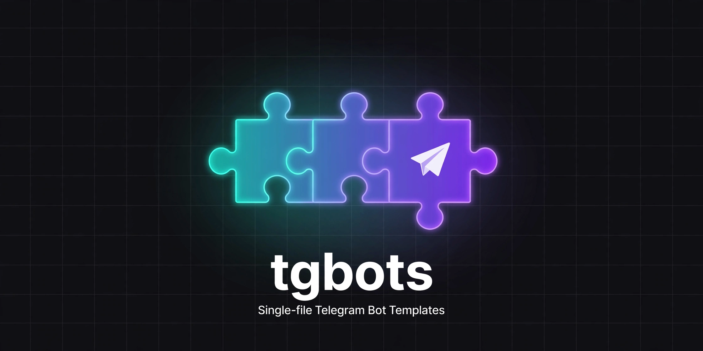

# 🧩 tgbots · Single-File Telegram Bot Templates

[中文](README.md) | **English** | [Русский](README.ru.md)

**40 everyday Telegram bots, each a single standalone `worker.js` file**: copy-paste into a Cloudflare Worker and deploy — zero dependencies, zero servers, runs on the Workers free tier. Plus **42 module docs** that break common capabilities into building blocks you can assemble into your own bot.

<a href="#-templates">📚 Templates</a> ·
<a href="modules/README.md">🧩 Modules</a> ·
<a href="docs/knowledge/README.md">📖 Knowledge Base</a> ·
<a href="docs/DEPLOY.md">🚀 Deploy</a> ·
<a href="docs/ASSEMBLY.md">🔧 Assembly</a> ·
<a href="docs/TESTING.md">🧪 Tests</a>

## ✨ Highlights

- 📄 **Truly single-file**: one bot = one `worker.js`, no build, no dependencies, drop it into a Worker and it runs
- 🧪 **Fully tested**: all 33 deployables verified live one by one; test records are public in [docs/TESTING.md](docs/TESTING.md)
- 🧩 **Building-block modules**: core modules are banner-commented (`【核心模块】`) and documented in the [module library](modules/README.md), ready to lift out and reuse
- 🎛️ **Tiered command menus**: admin commands only appear in admins' menus (whitelist + scoped registration); regular users never see them
- 🔐 **Secure by default**: tokens only in Secrets, signed webhooks, admins whitelisted by numeric ID
- 💸 **Zero cost**: state in free KV, files stored on Telegram itself, no server to buy

## 🚀 Quick Start

1. Create a bot with @BotFather and get the token
2. Create a Cloudflare Worker and paste in a `worker.js`
3. Set `BOT_TOKEN` (as a Secret) and other config in the Worker's variables
4. Open `https://your-worker-url/setWebhook?key=YOUR_WEBHOOK_SECRET`
5. Go back to Telegram and test the commands

Step-by-step with screenshots, how to find every ID, how to bind KV, common errors: see [docs/DEPLOY.md](docs/DEPLOY.md) (in Chinese).

## 🗂️ Navigation

[Templates](#-templates) · [Module Library](modules/README.md) · [Deploy Guide](docs/DEPLOY.md) · [Design](docs/DESIGN.md) · [Assembly Guide](docs/ASSEMBLY.md) · [Test Records](docs/TESTING.md) · [Global Survey](docs/SURVEY.md)

## 📚 Templates

| # | Type | Directory | What it does | Needs KV |
|---|------|------|--------|:---:|
| 01 | Channel Publisher | [01-channel-publisher](01-channel-publisher/) | Draft in DM → preview → publish to channel, with web panel and link buttons | No |
| 02 | Two-Way Support | [02-two-way-support](02-two-way-support/) | User messages forwarded to admin; admin replies reach the user (support desk) | No |
| 03 | Force Subscribe | [03-force-subscribe](03-force-subscribe/) | Users must join specified channels/groups to use the bot or speak in the group | No |
| 04 | Group Manager | [04-group-manager](04-group-manager/) | Join captcha, welcome, bad-word/link filters, /ban /mute commands | No |
| 05 | Submission Review | [05-submission-review](05-submission-review/) | User submissions → one-tap approval in review group → published to channel | No |
| 06 | File Sharing | [06-file-store](06-file-store/) | Send a file, get a share link; anyone with the link can fetch it from the bot | ✅ |
| 07 | Menu / Auto-Reply | [07-menu-faq](07-menu-faq/) | Multi-level menus + keyword auto-replies; edit the CONFIG block to change content | No |
| 08 | ID Tools | [08-id-tools](08-id-tools/) | Look up user/group/channel IDs and file_id; pairs with every other bot | No |
| 09 | Broadcast | [09-broadcast](09-broadcast/) | /start to subscribe, admin /broadcast to notify everyone | ✅ |
| 10 | Cloud Drive | [10-cloud-drive](10-cloud-drive/) | Files stored in a private channel as the disk: list/search/tags/share links | ✅ |
| 11 | RSS Push | [11-rss-push](11-rss-push/) | Cron fetches RSS feeds and pushes new posts to a channel, KV-deduplicated | ✅ |
| 12 | Join Request Review | [12-join-request](12-join-request/) | Three modes: button review / instant approve / quiz review | Quiz mode |
| 13 | Check-in & Lottery | [13-checkin-lottery](13-checkin-lottery/) | Daily check-in with streak bonus, points leaderboard, button-entry lottery | ✅ |
| 14 | Paid Membership | [14-paid-membership](14-paid-membership/) | Sell memberships: payment confirmed → invite link sent, expired members kicked | ✅ |
| 15 | Digital Goods Shop | [15-digital-shop](15-digital-shop/) | Auto-delivery of codes/links, stock management, delivery after confirmation | ✅ |
| 16 | Referral Stats | [16-referral](16-referral/) | Deep-link + per-user group invite link attribution, invite leaderboard (compliant stats) | ✅ |
| 17 | Task & Earn | [17-task-earn](17-task-earn/) | Post tasks to earn points: join tasks auto-verified, redemptions reviewed | ✅ |
| 18 | Channel Directory | [18-channel-directory](18-channel-directory/) | Channels self-submit for reviewed listing; category browse/search/random | ✅ |
| 19 | Polls | [19-poll-vote](19-poll-vote/) | Button voting, changeable or anonymous votes, results on close | ✅ |
| 20 | Push API | [20-push-api](20-push-api/) | An HTTP endpoint for your scripts/servers to send Telegram messages (ServerChan-style) | No |
| 21 | Scheduled Posts | [21-scheduled-post](21-scheduled-post/) | Auto-post announcements to channels/groups daily or weekly | ✅ |
| 22 | Group Activity Stats | [22-group-stats](22-group-stats/) | Daily message counts, chatter leaderboard, joins/leaves; today & 7-day reports | ✅ |
| 23 | Crypto Prices | [23-crypto-price](23-crypto-price/) | Price lookup + price alerts + scheduled broadcasts (Binance public API) | Alerts only |
| 24 | Chain Sign-up | [24-chain-signup](24-chain-signup/) | Group activity relay sign-ups: button to join the list, finalized on close | ✅ |
| 25 | Ledger | [25-ledger](25-ledger/) | One-line bookkeeping: shared group or personal ledger, monthly statements | ✅ |
| 26 | Quiz Game | [26-quiz-game](26-quiz-game/) | Group buzzer quiz with scoring and a season leaderboard (question bank in code) | ✅ |
| 27 | Translator | [27-translate](27-translate/) | Auto two-way translation in DM, reply with /fy in groups (free endpoint) | No |
| 28 | Toolbox | [28-toolbox](28-toolbox/) | QR codes, short links, hashes, Base64, UUID, random pick, timestamps | No |
| 29 | Anonymous Inbox | [29-anonymous-box](29-anonymous-box/) | A personal link to receive anonymous messages; replies go back anonymously | ✅ |
| 30 | Support Tickets | [30-support-ticket](30-support-ticket/) | Numbered tickets + support-group collaboration, close with a button | ✅ |
| 31 | AI Chat | [31-ai-chat](31-ai-chat/) | OpenAI-compatible chat: per-user context, personas, /reset, daily quota | ✅ |
| 32 | Mother Bot | [32-mother-bot](32-mother-bot/) | Clone platform: FSM onboarding, encrypted token custody, multi-tenant dispatch | ✅ |
| 33 | Mall Bot | [33-mall-bot](33-mall-bot/) | Franchise shops: HQ catalog, your own storefront bot, owner-confirmed delivery | ✅ |
| 34 | Video Download | [34-video-download](34-video-download/) | Link parsing via a replaceable resolver, files up to 50MB sent back | ✅ |
| 35 | Speech to Text | [35-speech-to-text](35-speech-to-text/) | Voice messages auto-transcribed (Whisper-compatible API) | ✅ |
| 36 | Personal Reminder | [36-personal-reminder](36-personal-reminder/) | Natural-language reminders, recurring schedules, todo list | ✅ |
| 37 | Sticker Maker | [37-sticker-maker](37-sticker-maker/) | Turn photos/files into sticker packs | ✅ |
| 38 | Weather | [38-weather](38-weather/) | Open-Meteo forecasts + daily forecast subscription | ✅ |
| 39 | GitHub Notify | [39-github-notify](39-github-notify/) | GitHub webhooks verified by HMAC and pushed as formatted messages | ✅ |
| 40 | Inline Tools | [40-inline-tools](40-inline-tools/) | Inline mode: search, unit conversion, calculator, timestamps in any chat | No |

Every directory has its own `README.md` (variable list + gotchas).

## 🧩 Module Library

Common capabilities are broken into 42 standalone module docs (principles + copy-paste real code + integration steps + caveats): foundation, admin whitelist & tiered menus, buttons & callbacks, KV storage, channel posting, force-subscribe checks, forward routing, file storage, Cron, review flow, group management, join-request review, payment & delivery, referral attribution, RSS, check-in & lottery, config-driven menus, quiz sessions, external APIs, FSM state machine, mother-bot multi-tenancy, shop catalog & cart, franchise malls, Stars payments, werewolf hosting, stickers, image/OCR tools, native polls & reactions, forum topics, URL upload, notify adapters, paid media, AI chat, inline mode, rate limiting & retries, Mini Apps, i18n, speech-to-text, advanced translation, video downloading, advanced group guarding, personal reminders. Start here when building your own: [modules/README.md](modules/README.md).

## Code Conventions (building blocks)

- Every `worker.js` marks its core modules with `【核心模块】` banner comments (transport layer, entry routes, main flow, and key sub-modules such as subscription checks and directory indexes), so you can lift whole blocks out and reuse them.
- Want to combine several bots into one? See [docs/ASSEMBLY.md](docs/ASSEMBLY.md) (five assembly steps + known conflicts + recommended combos).

## Combos (combos/)

Ready-made combinations of single bots, each still a single deployable file:

| Combo | Directory | Made of |
|------|--------|------|
| Channel Ops Suite | [combos/combo-channel-ops](combos/combo-channel-ops/) | 01 posting + 05 submissions + 02 two-way |
| Community Guard | [combos/combo-group-guard](combos/combo-group-guard/) | 03 force-subscribe + 04 group manager |
| Gated Drive | [combos/combo-drive-gate](combos/combo-drive-gate/) | 03 force-subscribe + 10 drive |

Index: [combos/README.md](combos/README.md).

## Security Notes

- **Put the bot token only in Cloudflare Secret variables. Never in code, never in chats.** If it leaks, reset it with /revoke at @BotFather.
- `WEBHOOK_SECRET` can be any long random string; it doubles as the password for `/setWebhook`.
- Stateless design: 01–05, 07, 08 need no database (they work off message forwards and coordinates encoded in buttons); 06, 09, 10, 11, 13, 14, 15, 16, 17, 18, 19, 21, 22, 24, 25, 26, 29, 30 need one KV binding (12 only in quiz mode, 23 only for price alerts; 20, 27, 28 need none). KV stores only small data (maps/rosters/indexes/ledgers); file payloads live on Telegram's servers.

## Suggested Combos

- Channel ops set: 01 posting + 05 submissions + 03 force-subscribe (growth) + 02 two-way (reader contact)
- Community set: 04 group manager + 03 force-subscribe guard (join the channel before speaking)
- Before configuring anything, deploy 08 first to look up the IDs you need — it saves a lot of pain.

## License

[MIT](LICENSE)
