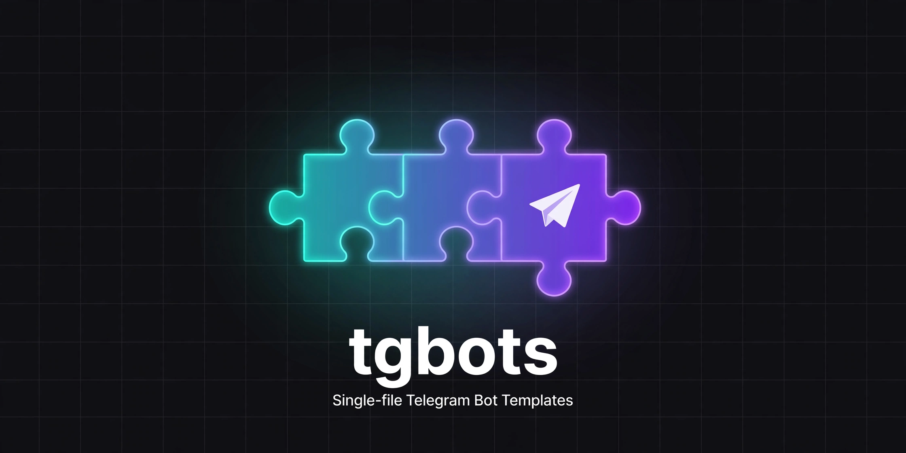

# 🧩 tgbots · Telegram Bot 单文件模板库

**中文** | [English](README.en.md) | [Русский](README.ru.md)

**82 个常用 Telegram Bot，每个都是一个独立的 `worker.js` 单文件**：复制粘贴到 Cloudflare Worker 即可部署——零依赖、零服务器、跑在 Workers 免费额度里。另有 **50 篇模块文档**把常用能力拆成积木，照着拼就能组出自己的 Bot。

<a href="#-模板目录">📚 模板目录</a> ·
<a href="modules/README.md">🧩 模块库</a> ·
<a href="docs/knowledge/README.md">📖 知识库</a> ·
<a href="docs/DEPLOY.md">🚀 部署文档</a> ·
<a href="docs/ASSEMBLY.md">🔧 拼装指南</a> ·
<a href="docs/TESTING.md">🧪 测试记录</a>

## ✨ 特色

- 📄 **真单文件**：一个 Bot = 一个 `worker.js`，无构建、无依赖，拖进 Worker 就跑
- 🧪 **全部实测**：85 个对象逐个真部署验证，测试记录公开在 [docs/TESTING.md](docs/TESTING.md)
- 🧩 **积木式模块**：核心模块都有 `【核心模块】` 注释横幅 + [模块库文档](modules/README.md)，整段拆出复用
- 🎛️ **分级命令菜单**：管理员命令只出现在管理员菜单里（白名单 + scope 注册），普通用户看不见
- 🔐 **安全默认**：Token 只进 Secret、webhook 带密钥校验、管理员按数字 ID 白名单
- 💸 **零成本**：状态存免费 KV、文件存 Telegram 本身，不用买服务器

## 🚀 快速开始

1. @BotFather 建 Bot 拿 Token
2. Cloudflare 新建 Worker，把某个 `worker.js` 粘贴部署
3. Worker 变量里填 `BOT_TOKEN`（设为 Secret）等配置
4. 打开 `https://你的Worker地址/setWebhook?key=你设的WEBHOOK_SECRET`
5. 回 Telegram 里发命令测试

手把手图文步骤、怎么查各种 ID、KV 怎么绑、常见报错：见 [docs/DEPLOY.md](docs/DEPLOY.md)。

## 🗂️ 导航

[模板目录](#-模板目录) · [模块库](modules/README.md) · [部署文档](docs/DEPLOY.md) · [设计文档](docs/DESIGN.md) · [拼装指南](docs/ASSEMBLY.md) · [测试记录](docs/TESTING.md)

## 📚 模板目录

| # | 类型 | 目录 | 一句话 | 需要 KV |
|---|------|------|--------|:---:|
| 01 | 频道发帖面板 | [01-channel-publisher](01-channel-publisher/) | 私聊发稿→预览→发布到频道，带网页面板和链接按钮 | 否 |
| 02 | 双向 Bot | [02-two-way-support](02-two-way-support/) | 用户留言转管理员，管理员回复即回达用户（客服） | 否 |
| 03 | 强制订阅 | [03-force-subscribe](03-force-subscribe/) | 未加入指定频道/群不能用 Bot、不能在群发言 | 否 |
| 04 | 群管理 | [04-group-manager](04-group-manager/) | 新人验证、欢迎、违禁词、防链接、ban/mute 命令 | 否 |
| 05 | 投稿审核 | [05-submission-review](05-submission-review/) | 用户投稿→审核群一键通过→发布到频道 | 否 |
| 06 | 文件分享 | [06-file-store](06-file-store/) | 发文件得专属链接，点链接找 Bot 领文件 | ✅ |
| 07 | 菜单/自动回复 | [07-menu-faq](07-menu-faq/) | 多级菜单 + 关键词自动回复，改配置区即改内容 | 否 |
| 08 | ID 查询工具 | [08-id-tools](08-id-tools/) | 查用户/群/频道 ID 和 file_id，配其它 Bot 用 | 否 |
| 09 | 订阅群发 | [09-broadcast](09-broadcast/) | /start 订阅、管理员 /broadcast 群发通知 | ✅ |
| 10 | 网盘（私有频道存储） | [10-cloud-drive](10-cloud-drive/) | 文件转存私有频道当硬盘，列表/搜索/标签/分享链接 | ✅ |
| 11 | RSS/定时推送 | [11-rss-push](11-rss-push/) | Cron 定时抓 RSS 新文章自动推频道，KV 去重 | ✅ |
| 12 | 入群申请审核 | [12-join-request](12-join-request/) | 加入申请三模式：按钮审核/秒通过/答题审核 | 答题模式需 |
| 13 | 签到积分/抽奖 | [13-checkin-lottery](13-checkin-lottery/) | 每日签到连签加成、积分榜、按钮报名抽奖 | ✅ |
| 14 | 付费会员 | [14-paid-membership](14-paid-membership/) | 卖会员：确认收款自动发邀请链接，到期自动踢 | ✅ |
| 15 | 数字商品售货 | [15-digital-shop](15-digital-shop/) | 卡密/链接自动发货，库存管理，确认后出货 | ✅ |
| 16 | 邀请引流统计 | [16-referral](16-referral/) | 深链+专属进群链接双归因，邀请榜（合规统计） | ✅ |
| 17 | 任务赚钱 | [17-task-earn](17-task-earn/) | 发任务攒积分：加入类自动验证，兑换走审核 | ✅ |
| 18 | 频道导航/互推 | [18-channel-directory](18-channel-directory/) | 频道自助提交审核收录，分类导航/搜索/随机 | ✅ |
| 19 | 投票问卷 | [19-poll-vote](19-poll-vote/) | 按钮投票可改票/可匿名，截止公布结果 | ✅ |
| 20 | 消息推送 API | [20-push-api](20-push-api/) | 给脚本/服务器一个发 TG 消息的网址接口（Server酱式） | 不用 |
| 21 | 定时播报 | [21-scheduled-post](21-scheduled-post/) | 每天/每周固定时间自动发公告到频道/群 | ✅ |
| 22 | 群活跃统计 | [22-group-stats](22-group-stats/) | 每日消息量/话痨榜/进退群，今日与近 7 天报表 | ✅ |
| 23 | 行情播报 | [23-crypto-price](23-crypto-price/) | 币价查询+价格提醒+定时播报（Binance 公共行情） | 提醒需 |
| 24 | 接龙报名 | [24-chain-signup](24-chain-signup/) | 群活动接龙：按钮报名排队名单，截止定版 | ✅ |
| 25 | 记账 | [25-ledger](25-ledger/) | 一句话记账：群共享/个人账本，按月汇总账单 | ✅ |
| 26 | 竞答游戏 | [26-quiz-game](26-quiz-game/) | 群里抢答出题计分，赛季总榜（题库在代码里） | ✅ |
| 27 | 翻译 | [27-translate](27-translate/) | 私聊自动互译、群里回复 /fy 翻译（免费接口） | 否 |
| 28 | 工具箱 | [28-toolbox](28-toolbox/) | 二维码/短链/哈希/Base64/UUID/随机选/时间戳 | 否 |
| 29 | 匿名信箱 | [29-anonymous-box](29-anonymous-box/) | 专属链接收匿名留言，回复即匿名回信 | ✅ |
| 30 | 客服工单 | [30-support-ticket](30-support-ticket/) | 带编号工单+客服群协作回复，按钮关单 | ✅ |
| 31 | AI 聊天 | [31-ai-chat](31-ai-chat/) | OpenAI 兼容接口聊天：上下文记忆、人设切换、用量上限 | ✅ |
| 32 | 母体 Bot | [32-mother-bot](32-mother-bot/) | 交 Token 克隆子 Bot：加密托管、内置客服/签到双内核 | ✅ |
| 33 | 商城 Bot | [33-mall-bot](33-mall-bot/) | 连锁商城：开店克隆门面、总部货源池、购物车下单 | ✅ |
| 34 | 视频解析下载 | [34-video-download](34-video-download/) | 贴链接选画质解析回传，可替换解析层，50MB 边界 | ✅ |
| 35 | 语音转文字 | [35-speech-to-text](35-speech-to-text/) | Whisper 兼容转写：私聊即转、群里开关自动转 | ✅ |
| 36 | 个人提醒/待办 | [36-personal-reminder](36-personal-reminder/) | 自然语言时间提醒+周期提醒+待办清单 | ✅ |
| 37 | 贴纸制作 | [37-sticker-maker](37-sticker-maker/) | 发图选 emoji 自动建贴纸包，规格处理可外置 | ✅ |
| 38 | 天气 | [38-weather](38-weather/) | Open-Meteo 免费源：查天气+订阅每日预报 | ✅ |
| 39 | GitHub 通知 | [39-github-notify](39-github-notify/) | 仓库 Webhook 验签接收，push/PR/Issue 推到聊天 | ✅ |
| 40 | Inline 工具 | [40-inline-tools](40-inline-tools/) | 任意聊天 @ 出卡片：词库搜索/换算/计算器/时间戳 | 不用 |
| 41 | 狼人杀主持人 | [41-werewolf](41-werewolf/) | 群里开局发牌、夜晚私聊行动、白天公投的阶段状态机 | ✅ |
| 42 | Mini App 三件套 | [42-mini-app](42-mini-app/) | 一个 Worker 同时是 Bot+网页+API，initData 验签+留言 | 建议 |
| 43 | 图片处理/OCR | [43-image-ocr](43-image-ocr/) | 发图提字、改尺寸转格式、引用图，全走外部服务编排 | 可选 |
| 44 | URL 上传转存 | [44-url-upload](44-url-upload/) | 外网链接三路分流搬进 TG，SSRF 拦截+取件码 | 可选 |
| 45 | 论坛话题工单 | [45-forum-ticket](45-forum-ticket/) | 一单一话题：客服在话题里回复即回达用户 | ✅ |
| 46 | 原生投票/竞答 | [46-native-poll](46-native-poll/) | sendPoll 原生投票与 quiz 记分排行、消息反应计数 | ✅ |
| 47 | 翻译进阶 | [47-translate-plus](47-translate-plus/) | 文档/语音/图片三管线翻译+群自动翻译开关 | 群开关需 |
| 48 | 联邦群管 | [48-fed-guard](48-fed-guard/) | 跨群共享封禁+CAS 垃圾库+群笔记+过滤器 | ✅ |
| 49 | PDF 工具 | [49-pdf-tools](49-pdf-tools/) | 图片本地拼 PDF、PDF 提文字、转图/合并/拆分走外部服务 | ✅ |
| 50 | 音乐下载/识曲 | [50-music](50-music/) | 贴链接下音频、发片段 AudD 识曲，每日限额 | ✅ |
| 51 | 游戏平台 | [51-game-platform](51-game-platform/) | Worker 自托管贪吃蛇/2048，sendGame 卡片+签名令牌记分 | 建议 |
| 52 | 匿名随机聊天 | [52-anon-chat](52-anon-chat/) | 队列配对匿名聊天，举报自动封禁+敏感词+规则确认全套安全配套 | ✅ |
| 53 | Business 代答 | [53-business-reply](53-business-reply/) | Telegram Business 账号代答：营业时间答疑、营业外留言转人工 | ✅ |
| 54 | Managed Bots 母体 | [54-managed-bots](54-managed-bots/) | Bot API 9.6 深链建 Bot，getManagedBotToken 取 token 加密代管 | ✅ |
| 55 | AI 绘图 | [55-ai-image](55-ai-image/) | /draw 文生图、/edit 改图，OpenAI images 兼容口径可换源 | 可选 |
| 56 | 课程/LMS | [56-course-lms](56-course-lms/) | 建课加课时、顺序学习、测验解锁、付费人工确认 | ✅ |
| 57 | 预约/订位 | [57-booking](57-booking/) | 服务/日期/时段三步预约，占用防撞+管理员确认+提前提醒 | ✅ |
| 58 | 闪卡记忆 | [58-flashcards](58-flashcards/) | SM-2 间隔重复背卡，每日到期提醒，零外部 API | ✅ |
| 59 | 长文总结 | [59-summarizer](59-summarizer/) | 链接/长文 LLM 总结，长文 map-reduce 分段摘要 | 无 |
| 60 | 网站更新监控 | [60-web-monitor](60-web-monitor/) | 无 RSS 站点快照哈希比对，变化推行级 diff 摘要 | ✅ |
| 61 | 活动抽奖 | [61-giveaway](61-giveaway/) | 按钮参与+订阅核验，定时/手动开奖，crypto 随机抽取 | ✅ |
| 62 | 加密支付 | [62-crypto-pay](62-crypto-pay/) | Crypto Pay 发票收款，Webhook 验签+幂等发货 | ✅ |
| 63 | 频道数据分析 | [63-channel-analytics](63-channel-analytics/) | 自有频道帖子采样统计+日报，深度数据留 TGStat 适配位 | ✅ |
| 64 | TTS 语音合成 | [64-tts](64-tts/) | 文本转语音条，OpenAI speech 兼容口径，长文分段 | 可选 |
| 65 | 电台/播客 | [65-radio-podcast](65-radio-podcast/) | 电台直播流导航+播客 RSS 订阅新单集推送 | ✅ |
| 66 | 直播开播提醒 | [66-live-alert](66-live-alert/) | YouTube 免 key/Twitch Helix 订阅，开播状态翻转才推 | ✅ |
| 67 | 包裹快递追踪 | [67-parcel-tracking](67-parcel-tracking/) | 17track 口径订阅追踪，轨迹变化推送、签收停追 | ✅ |
| 68 | 机票/旅行助手 | [68-travel-assistant](68-travel-assistant/) | 航班查询适配、低价订阅、行程单起飞前提醒 | ✅ |
| 69 | 求职招聘 | [69-job-board](69-job-board/) | 发岗审核上架、按城市搜索、投递转发企业 | ✅ |
| 70 | 房产租售提醒 | [70-real-estate](70-real-estate/) | 订阅城市/户型/预算，新房源去重推送（数据源自接） | ✅ |
| 71 | 星座运势/塔罗 | [71-horoscope](71-horoscope/) | 本地种子确定性每日运势+22 大阿卡纳抽牌，娱乐定位 | 可选 |
| 72 | 每日经文 | [72-daily-verse](72-daily-verse/) | 公版译本经文轮换+礼拜时间查询+订阅推送 | ✅ |
| 73 | 公版书库 | [73-gutenberg-library](73-gutenberg-library/) | Gutendex 免 key 搜书取书，只收公版书 | 可选 |
| 74 | DAO 治理提醒 | [74-dao-alerts](74-dao-alerts/) | Snapshot 提案轮询，新提案/状态变化推送 | ✅ |
| 75 | NFT 动态提醒 | [75-nft-alerts](75-nft-alerts/) | 合约事件轮询适配层，mint/成交推送 | ✅ |
| 76 | 电商比价追踪 | [76-price-tracker](76-price-tracker/) | 商品链接订阅查价，降价超阈值推送+30 天价格史 | ✅ |
| 77 | 相亲交友 | [77-dating-match](77-dating-match/) | 建卡浏览双向喜欢配对，18+ 确认+举报封禁安全配套 | ✅ |
| 78 | VPN 面板交付 | [78-vpn-panel](78-vpn-panel/) | 收款后 Marzban/3X-UI 自动开号发订阅链接，到期禁用 | ✅ |
| 79 | 习惯打卡/番茄钟 | [79-habit-pomodoro](79-habit-pomodoro/) | 习惯连续打卡统计+番茄钟到期提醒 | ✅ |
| 80 | 匿名提问墙 | [80-anon-qa-wall](80-anon-qa-wall/) | 匿名提问上墙公开作答，身份永不进频道 | ✅ |
| 81 | 域名/SSL 监控 | [81-domain-monitor](81-domain-monitor/) | RDAP 查到期+证书探针，30/7/1 天分级提醒 | ✅ |
| 82 | AI 头像/证件照 | [82-ai-avatar](82-ai-avatar/) | AI 风格头像+证件照规格裁剪，隐私提示不落盘 | 可选 |

每个目录里都有自己的 `README.md`（变量清单 + 注意事项）。

## 🧩 模块库

常用能力已拆成 45 篇独立模块文档（原理 + 可复制的真实代码 + 接入步骤 + 注意点）：基础骨架、管理员白名单与分级菜单、按钮与回调、KV 存储、频道发帖、强制订阅、转发路由、文件存储、Cron、审核流、群管理、入群审核、支付发货、邀请归因、RSS、签到抽奖、配置菜单、竞答会话、外部 API、状态机 FSM、母体多租户、商店购物车、商城连锁、Stars 支付、AI 对话、Inline 模式、限流重试、Mini App、多语言、语音转文字、翻译进阶、视频下载、群管进阶、个人提醒、狼人杀、贴纸制作、图片/OCR、原生投票与反应、论坛话题、URL 转存、通知适配器、付费媒体、PDF 工具、音乐下载识曲、游戏平台。写新 Bot 先来挑积木：[modules/README.md](modules/README.md)。

## 代码规范（积木式模块）

- 每个 `worker.js` 的核心模块都用 `【核心模块】` 横幅注释标注（通信层、入口路由、业务主流程，以及各自的关键子模块如订阅校验、目录索引等），照着横幅就能整段拆出来复用。
- 想把几个 Bot 拼成一个：看 [docs/ASSEMBLY.md](docs/ASSEMBLY.md)（组装五步 + 已知冲突清单 + 现成组合推荐）。

> 🧩 **模块库**：常用能力已拆成独立模块文档（原理+可复制代码+接入步骤），见 [modules/](modules/README.md)。

## 拼装组合（combos/）

单体拼成的成品组合，各占一个子目录、依然单文件部署：

| 组合 | 子目录 | 拼装 |
|------|--------|------|
| 频道运营全家桶 | [combos/combo-channel-ops](combos/combo-channel-ops/) | 01 发帖 + 05 投稿 + 02 双向 |
| 社群守卫 | [combos/combo-group-guard](combos/combo-group-guard/) | 03 强订 + 04 群管理 |
| 强订网盘 | [combos/combo-drive-gate](combos/combo-drive-gate/) | 03 强订 + 10 网盘 |

索引见 [combos/README.md](combos/README.md)。

## 安全须知

- **Bot Token 只填进 Cloudflare 的 Secret 变量里，不要写进代码、不要发到聊天/群里。** 泄露后去 @BotFather 用 /revoke 重置。
- `WEBHOOK_SECRET` 随便编一串长随机字符即可，它同时是 `/setWebhook` 的访问口令。
- 无状态设计：01–05、07、08 不用任何数据库（靠消息转发/按钮里编码的坐标工作）；06、09、10、11、13、14、15、16、17、18、19、21、22、24、25、26、29、30、31、32、33、34、35、36、37、39、41、45、46、48、49、50 需要绑定一个 KV（12 仅答题模式、23 仅价格提醒、38 仅订阅功能、47 仅群自动翻译开关需要；42 留言、43 用量计数、44 取件码、51 总榜为可选绑定，不绑只少对应功能；20、27、28、40 不用）；KV 只存小数据（映射/名单/索引/账本），文件本体都在 Telegram 服务器上。

## 组合玩法

- 频道运营套装：01 发帖 + 05 投稿 + 03 强制订阅（涨粉）+ 02 双向（读者联系）
- 社群套装：04 群管理 + 03 强制订阅守卫（进群先订频道）
- 配置任何一个之前，先部署 08 查好要用的 ID，能少踩很多坑。
