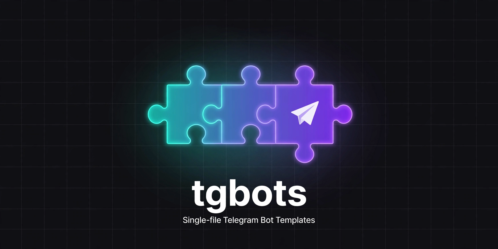

# 🧩 tgbots · Однофайловые шаблоны Telegram-ботов

[中文](README.md) | [English](README.en.md) | **Русский**

**82 повседневных Telegram-бота, каждый — один самостоятельный файл `worker.js`**: скопируйте в Cloudflare Worker и деплойте — ноль зависимостей, ноль серверов, работает на бесплатном тарифе Workers. Плюс **50 модульных документов**, разбирающих типовые возможности на «кубики», из которых можно собрать своего бота.

<a href="#-шаблоны">📚 Шаблоны</a> ·
<a href="modules/README.md">🧩 Модули</a> ·
<a href="docs/knowledge/README.md">📖 База знаний</a> ·
<a href="docs/DEPLOY.md">🚀 Деплой</a> ·
<a href="docs/ASSEMBLY.md">🔧 Сборка</a> ·
<a href="docs/TESTING.md">🧪 Тесты</a>

## ✨ Особенности

- 📄 **По-настоящему один файл**: один бот = один `worker.js`, без сборки и зависимостей
- 🧪 **Всё протестировано**: все 54 объекта проверены живым деплоем по одному; записи тестов открыты в [docs/TESTING.md](docs/TESTING.md)
- 🧩 **Модульные «кубики»**: ключевые модули помечены баннерами `【核心模块】` и описаны в [библиотеке модулей](modules/README.md)
- 🎛️ **Многоуровневые меню команд**: админские команды видны только в меню админов (белый список + scope), обычные пользователи их не видят
- 🔐 **Безопасность по умолчанию**: токен только в Secret, подписанные вебхуки, админы — по числовым ID
- 💸 **Ноль затрат**: состояние — в бесплатном KV, файлы — на серверах Telegram, сервер покупать не нужно

## 🚀 Быстрый старт

1. Создайте бота у @BotFather и получите токен
2. Создайте Cloudflare Worker и вставьте `worker.js`
3. Укажите `BOT_TOKEN` (как Secret) и прочие переменные
4. Откройте `https://адрес-воркера/setWebhook?key=ВАШ_WEBHOOK_SECRET`
5. Вернитесь в Telegram и тестируйте команды

Подробная инструкция с картинками — [docs/DEPLOY.md](docs/DEPLOY.md) (на китайском).

## 🗂️ Навигация

[Шаблоны](#-шаблоны) · [Библиотека модулей](modules/README.md) · [Деплой](docs/DEPLOY.md) · [Дизайн](docs/DESIGN.md) · [Сборка](docs/ASSEMBLY.md) · [Тесты](docs/TESTING.md) · [Мировой обзор](docs/SURVEY.md)

## 📚 Шаблоны

| # | Тип | Каталог | Что делает | Нужен KV |
|---|------|------|--------|:---:|
| 01 | Публикация в канал | [01-channel-publisher](01-channel-publisher/) | Черновик в личке → предпросмотр → публикация в канал, веб-панель и кнопки-ссылки | Нет |
| 02 | Двусторонняя поддержка | [02-two-way-support](02-two-way-support/) | Сообщения пользователей — админу, ответы админа доходят до пользователя | Нет |
| 03 | Принудительная подписка | [03-force-subscribe](03-force-subscribe/) | Без подписки на указанные каналы/группы ботом пользоваться нельзя | Нет |
| 04 | Управление группой | [04-group-manager](04-group-manager/) | Капча для новичков, приветствия, фильтры слов/ссылок, /ban /mute | Нет |
| 05 | Модерация投稿 | [05-submission-review](05-submission-review/) | 投稿 пользователей → одобрение кнопкой в группе модерации → публикация в канал | Нет |
| 06 | Обмен файлами | [06-file-store](06-file-store/) | Отправь файл — получи ссылку; по ссылке файл выдаёт бот | ✅ |
| 07 | Меню / автоответы | [07-menu-faq](07-menu-faq/) | Многоуровневые меню + автоответы по ключевым словам, контент — в блоке CONFIG | Нет |
| 08 | Инструменты ID | [08-id-tools](08-id-tools/) | ID пользователей/групп/каналов и file_id; пара к любому другому боту | Нет |
| 09 | Рассылка подписчикам | [09-broadcast](09-broadcast/) | /start — подписка, /broadcast у админа — уведомление всем | ✅ |
| 10 | Облачный диск | [10-cloud-drive](10-cloud-drive/) | Файлы хранятся в приватном канале: список/поиск/теги/ссылки | ✅ |
| 11 | RSS-пуш | [11-rss-push](11-rss-push/) | Cron забирает RSS и пушит новые статьи в канал, дедуп через KV | ✅ |
| 12 | Заявки на вступление | [12-join-request](12-join-request/) | Три режима: кнопки / мгновенно / викторина | Режим викторины |
| 13 | Чек-ин и лотерея | [13-checkin-lottery](13-checkin-lottery/) | Ежедневный чек-ин со стриком, таблица баллов, лотерея по кнопке | ✅ |
| 14 | Платное членство | [14-paid-membership](14-paid-membership/) | Продажа подписки: подтверждение оплаты → инвайт-ссылка, истёкших — кик | ✅ |
| 15 | Магазин цифровых товаров | [15-digital-shop](15-digital-shop/) | Автовыдача кодов/ссылок, учёт остатков, выдача после подтверждения | ✅ |
| 16 | Реферальная статистика | [16-referral](16-referral/) | Атрибуция по диплинкам и персональным инвайтам в группу, таблица лидеров | ✅ |
| 17 | Задания и заработок | [17-task-earn](17-task-earn/) | Задания за баллы: вступление проверяется автоматически, обмен — через модерацию | ✅ |
| 18 | Каталог каналов | [18-channel-directory](18-channel-directory/) | Каналы подают заявки на размещение; каталог/поиск/случайный канал | ✅ |
| 19 | Голосования | [19-poll-vote](19-poll-vote/) | Голосование кнопками, можно менять голос / анонимно, итоги по закрытии | ✅ |
| 20 | Push API | [20-push-api](20-push-api/) | HTTP-интерфейс для ваших скриптов и серверов (аналог ServerChan) | Нет |
| 21 | Посты по расписанию | [21-scheduled-post](21-scheduled-post/) | Ежедневные/еженедельные объявления в канал или группу | ✅ |
| 22 | Статистика группы | [22-group-stats](22-group-stats/) | Сообщения за день, топ болтунов, входы/выходы; отчёты за день и 7 дней | ✅ |
| 23 | Курсы криптовалют | [23-crypto-price](23-crypto-price/) | Цены + алерты + рассылка по расписанию (публичный API Binance) | Только алерты |
| 24 | Цепочка записи | [24-chain-signup](24-chain-signup/) | Запись на активности кнопкой, список финализируется по закрытии | ✅ |
| 25 | Учёт денег | [25-ledger](25-ledger/) | Учёт одной строкой: общий групповой или личный, сводка за месяц | ✅ |
| 26 | Викторина | [26-quiz-game](26-quiz-game/) | Игра на скорость ответа в группе, сезонная таблица (вопросы — в коде) | ✅ |
| 27 | Переводчик | [27-translate](27-translate/) | Автоперевод в личке, в группе — ответом с /fy (бесплатный API) | Нет |
| 28 | Инструменты | [28-toolbox](28-toolbox/) | QR-коды, короткие ссылки, хэши, Base64, UUID, случайный выбор, время | Нет |
| 29 | Анонимный ящик | [29-anonymous-box](29-anonymous-box/) | Персональная ссылка для анонимных сообщений; ответы — тоже анонимно | ✅ |
| 30 | Тикеты поддержки | [30-support-ticket](30-support-ticket/) | Тикеты с номерами + совместная работа в группе поддержки, закрытие кнопкой | ✅ |
| 31 | AI-чат | [31-ai-chat](31-ai-chat/) | Чат на OpenAI-совместимом API: контекст, персоны, /reset, дневной лимит | ✅ |
| 32 | Материнский бот | [32-mother-bot](32-mother-bot/) | Платформа клонов: онбординг FSM, зашифрованное хранение токенов, мультитенант | ✅ |
| 33 | Торговый центр | [33-mall-bot](33-mall-bot/) | Франшизные магазины: каталог HQ, свой бот-витрина, выдача после подтверждения | ✅ |
| 34 | Скачивание видео | [34-video-download](34-video-download/) | Разбор ссылок через сменный резолвер, файлы до 50MB — обратно в чат | ✅ |
| 35 | Речь в текст | [35-speech-to-text](35-speech-to-text/) | Авторасшифровка голосовых (Whisper-совместимый API) | ✅ |
| 36 | Личные напоминания | [36-personal-reminder](36-personal-reminder/) | Напоминания обычным языком, повторы, список дел | ✅ |
| 37 | Создание стикеров | [37-sticker-maker](37-sticker-maker/) | Фото/файлы → стикерпаки | ✅ |
| 38 | Погода | [38-weather](38-weather/) | Прогнозы Open-Meteo + ежедневная подписка | ✅ |
| 39 | GitHub-уведомления | [39-github-notify](39-github-notify/) | Вебхуки GitHub с проверкой HMAC, форматированные уведомления | ✅ |
| 40 | Inline-инструменты | [40-inline-tools](40-inline-tools/) | Inline-режим: поиск, конвертер, калькулятор, время — в любом чате | Нет |
| 41 | Ведущий «Мафии» | [41-werewolf](41-werewolf/) | Групповая игра: роли в личку, ночные действия, дневное голосование | ✅ |
| 42 | Mini App набор | [42-mini-app](42-mini-app/) | Один Worker = бот + страница + API, проверка initData, гостевая книга | Рекомендуется |
| 43 | Картинки / OCR | [43-image-ocr](43-image-ocr/) | OCR фото, размер/формат, картинки-цитаты — оркестрация внешних сервисов | Опционально |
| 44 | Загрузка по URL | [44-url-upload](44-url-upload/) | Файлы из веба в Telegram тремя маршрутами, защита от SSRF, коды выдачи | Опционально |
| 45 | Тикеты в темах форума | [45-forum-ticket](45-forum-ticket/) | Один тикет = одна тема; ответы поддержки в теме доходят до пользователя | ✅ |
| 46 | Нативные опросы / викторины | [46-native-poll](46-native-poll/) | Голосования sendPoll и викторины с подсчётом и рейтингом, счётчик реакций | ✅ |
| 47 | Перевод Плюс | [47-translate-plus](47-translate-plus/) | Перевод документов/голоса/картинок + автоперевод в группах | Для группового переключателя |
| 48 | Федеративная защита | [48-fed-guard](48-fed-guard/) | Общие баны между группами + блоклист CAS + заметки + фильтры | ✅ |
| 49 | PDF-инструменты | [49-pdf-tools](49-pdf-tools/) | Картинки в PDF локально на чистом JS; извлечение/конвертация — внешние сервисы | ✅ |
| 50 | Музыка | [50-music](50-music/) | Скачивание аудио через резолвер, распознавание AudD, дневной лимит | ✅ |
| 51 | Игровая платформа | [51-game-platform](51-game-platform/) | Змейка/2048 на самом Worker, карточки sendGame, очки по подписанному токену | Рекомендуется |
| 52 | Анонимный случайный чат | [52-anon-chat](52-anon-chat/) | Анонимный чат по очереди: жалобы, автобан, фильтр слов, подтверждение правил | ✅ |
| 53 | Автоответчик Business | [53-business-reply](53-business-reply/) | Делегат Telegram Business: ответы по ключевым словам, вне часов — пересылка владельцу | ✅ |
| 54 | Хост Managed Bots | [54-managed-bots](54-managed-bots/) | Создание ботов по глубокой ссылке (Bot API 9.6), зашифрованное хранение токенов | ✅ |
| 55 | AI-рисование | [55-ai-image](55-ai-image/) | /draw генерация, /edit редактирование, совместимость с OpenAI images | Опционально |
| 56 | Курсы / LMS | [56-course-lms](56-course-lms/) | Курсы и уроки по порядку, тесты-«ворота», платная разблокировка | ✅ |
| 57 | Бронирование | [57-booking](57-booking/) | Услуга/дата/время, защита от двойной записи, напоминания | ✅ |
| 58 | Флеш-карточки | [58-flashcards](58-flashcards/) | Интервальное повторение SM-2, напоминания, ноль внешних API | ✅ |
| 59 | Суммаризатор | [59-summarizer](59-summarizer/) | LLM-резюме ссылок и длинных текстов, map-reduce для статей | Нет |
| 60 | Мониторинг изменений сайтов | [60-web-monitor](60-web-monitor/) | Снапшоты и хэш-дифф для сайтов без RSS, построчный дайджест изменений | ✅ |
| 61 | Розыгрыши | [61-giveaway](61-giveaway/) | Участие кнопкой + проверка подписки, розыгрыш по расписанию, крипто-рандом | ✅ |
| 62 | Crypto Pay | [62-crypto-pay](62-crypto-pay/) | Счета Crypto Pay, проверка подписи вебхука, идемпотентная выдача | ✅ |
| 63 | Аналитика канала | [63-channel-analytics](63-channel-analytics/) | Сэмплирование постов своего канала + дневной отчёт, слот под TGStat | ✅ |
| 64 | TTS | [64-tts](64-tts/) | Текст в голосовые, совместимость с OpenAI speech, длинные тексты частями | Опционально |
| 65 | Радио / подкасты | [65-radio-podcast](65-radio-podcast/) | Гид по радиостримам + подписки на подкасты RSS с пушем новых выпусков | ✅ |
| 66 | Алерты о стримах | [66-live-alert](66-live-alert/) | YouTube без ключа / Twitch Helix, алерты только при смене состояния | ✅ |
| 67 | Отслеживание посылок | [67-parcel-tracking](67-parcel-tracking/) | Подписки 17track, пуш при изменениях, автостоп при доставке | ✅ |
| 68 | Тревел-ассистент | [68-travel-assistant](68-travel-assistant/) | Адаптер рейсов, подписки на цены, напоминания перед вылетом | ✅ |
| 69 | Доска вакансий | [69-job-board](69-job-board/) | Вакансии с модерацией, поиск по городу, отклики — работодателю | ✅ |
| 70 | Алерты недвижимости | [70-real-estate](70-real-estate/) | Подписки город/комнаты/бюджет, дедуп новых объявлений (источник свой) | ✅ |
| 71 | Гороскоп / Таро | [71-horoscope](71-horoscope/) | Локальные ежедневные гороскопы + 22 старших аркана, развлекательный формат | Опционально |
| 72 | Стих дня | [72-daily-verse](72-daily-verse/) | Ротация текстов из общедоступных переводов, время молитв, подписка | ✅ |
| 73 | Библиотека общественного достояния | [73-gutenberg-library](73-gutenberg-library/) | Поиск и выдача книг через Gutendex без ключа, только public domain | Опционально |
| 74 | DAO-алерты | [74-dao-alerts](74-dao-alerts/) | Опрос Snapshot, алерты о новых/изменившихся предложениях | ✅ |
| 75 | NFT-алерты | [75-nft-alerts](75-nft-alerts/) | Адаптер событий контрактов, алерты минтов/продаж | ✅ |
| 76 | Трекер цен | [76-price-tracker](76-price-tracker/) | Наблюдение за ценами по ссылкам, алерты о снижении + история за 30 дней | ✅ |
| 77 | Знакомства | [77-dating-match](77-dating-match/) | Анкеты, взаимные лайки, подтверждение 18+ и набор безопасности | ✅ |
| 78 | Выдача VPN-панелей | [78-vpn-panel](78-vpn-panel/) | Marzban/3X-UI: автoсоздание аккаунта после оплаты, отключение по истечении | ✅ |
| 79 | Привычки / Помодоро | [79-habit-pomodoro](79-habit-pomodoro/) | Стрики привычек + напоминания о конце помодоро | ✅ |
| 80 | Анонимная стена вопросов | [80-anon-qa-wall](80-anon-qa-wall/) | Анонимные вопросы публикуются открыто, личность не попадает в канал | ✅ |
| 81 | Мониторинг доменов / SSL | [81-domain-monitor](81-domain-monitor/) | Истечение по RDAP + проба сертификата, алерты за 30/7/1 дней | ✅ |
| 82 | AI-аватар / фото на документы | [82-ai-avatar](82-ai-avatar/) | Стильные аватары + размеры фото на документы, ничего не сохраняется | Опционально |

В каждом каталоге свой `README.md` (переменные + подводные камни).

## 🧩 Библиотека модулей

Типовые возможности разобраны на 50 отдельных модульных документов (принцип + готовый код + шаги подключения + подводные камни): фундамент, белый список админов и многоуровневые меню, кнопки и колбэки, хранилище KV, публикация в канал, проверка подписки, маршрутизация пересылки, файловое хранилище, Cron, поток модерации, управление группой, заявки на вступление, оплата и выдача, реферальная атрибуция, RSS, чек-ин и лотерея, меню из конфига, викторины, внешние API, конечный автомат FSM, мультитенантная «материнская» платформа, каталог и корзина магазина, франшизные магазины, платежи Stars. Начните отсюда: [modules/README.md](modules/README.md).

## Комбинации (combos/)

| Комбинация | Каталог | Состав |
|------|--------|------|
| Канал под ключ | [combos/combo-channel-ops](combos/combo-channel-ops/) | 01 публикация + 05 модерация + 02 поддержка |
| Страж сообщества | [combos/combo-group-guard](combos/combo-group-guard/) | 03 подписка + 04 управление группой |
| Диск за подпиской | [combos/combo-drive-gate](combos/combo-drive-gate/) | 03 подписка + 10 диск |

Индекс: [combos/README.md](combos/README.md).

## Безопасность

- **Токен бота — только в Secret-переменных Cloudflare. Никогда в коде и в чатах.** Утёк — сбросьте через /revoke у @BotFather.
- `WEBHOOK_SECRET` — любая длинная случайная строка; она же пароль для `/setWebhook`.
- KV хранит только мелкие данные (карты/списки/индексы/журналы); сами файлы живут на серверах Telegram.

## Лицензия

[MIT](LICENSE)
