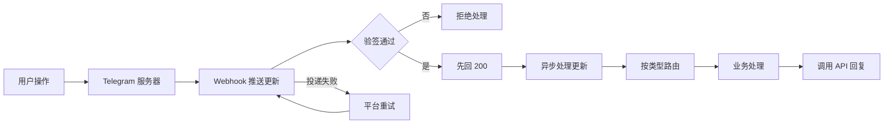

# 03 · 更新与 Webhook

## 本篇讲什么

你的代码是怎么「收到消息」的：Update 有哪些类型、Webhook 和长轮询怎么选、webhook 的验签与重试语义、allowed_updates 为什么必须裁剪。这是 Bot 的消息总线，理解错了后面全是灵异 bug。

先看全景——一条更新的完整旅程：

## 核心概念

### Update：一包事件，只装一件

每个 Update 有全局递增的 `update_id` 和**恰好一个**事件字段。常见类型（全集以官方文档为准）：

| 字段 | 什么时候来 | 本库谁在用 |
|---|---|---|
| `message` | 新消息（私聊/群/频道转发等） | 几乎所有模板 |
| `edited_message` | 消息被编辑 | 按需 |
| `channel_post` / `edited_channel_post` | 频道发帖/编辑 | 频道类玩法 |
| `callback_query` | 有人点了 inline 按钮 | 模块 03 的一切按钮 |
| `inline_query` / `chosen_inline_result` | Inline 模式查询/选中 | 模块 26 |
| `pre_checkout_query` / 支付相关字段 | 付款复核（成功付款在 message 里） | 模块 24 |
| `poll` / `poll_answer` | 原生投票状态/用户投票 | 模块 19 的原生模式 |
| `my_chat_member` | Bot 自己在群里的身份变化（被拉进/被踢） | 群类 Bot 感知生死 |
| `chat_member` | 群成员变化（需管理员权限+显式订阅） | 16 邀请归因、22 统计 |
| `chat_join_request` | 有人申请加入申请制群 | 模板 12 |
| `message_reaction` 等较新类型 | 消息被加表情回应 | 进阶玩法 |

### 两种收货方式

- **长轮询（getUpdates）**：你的程序不停地问「有新消息吗」。适合本地开发、内网服务、没有公网地址的场景。缺点：同一 Bot 同时只能有一处在轮询，且与 webhook 互斥。
- **Webhook**：Telegram 主动把更新 POST 到你的 HTTPS 地址。适合云端无服务器部署（本库的 Workers 就是为此而生）：没流量时零成本、零驻留进程。缺点：需要公网 HTTPS 地址，调试不如本地直观。

### Webhook 的四个关键参数

- `url`：你的接收地址。
- `secret_token`：你自设的密钥，Telegram 会在每次推送的请求头 `x-telegram-bot-api-secret-token` 里带上它——**服务端必须逐条校验**，否则任何人伪造一个 POST 就能骗你的 Bot 干活。
- `allowed_updates`：只订阅你要的类型。少订 = 少流量、少噪声、少踩「没处理的类型被当成 bug」的坑；漏订 = 对应事件永远收不到（最经典的是漏了 `callback_query` 导致按钮点了没反应）。
- `max_connections`、`drop_pending_updates`：并发连接上限、切 webhook 时是否丢弃积压更新，按需设置（以官方文档为准）。

### 投递语义：会重试，不保证顺序

推送失败（非 2xx、超时），Telegram 会重试一段时间后放弃；所以你的端点要**先回 200 再慢慢处理**（Workers 里用 `ctx.waitUntil` 就是这个道理）。重试意味着同一更新可能到两次——关键动作（发货、扣分）必须按 update_id 或业务幂等键去重。跨 chat 的更新顺序也不保证，逻辑别依赖全局时序。

## 实操要点

1. 端点逻辑保持薄：验签 → 解析 → 入队/异步处理 → 立刻 200。重活放异步（见 08、10 篇）。
2. 上线前用 `getWebhookInfo` 自检：url 对不对、pending_update_count 积压多少、last_error_message 说了什么（见 11 篇）。
3. 从轮询切到 webhook 前先 `deleteWebhook` 反之亦然，混用只会互相抢更新。
4. 每个 Bot 的 allowed_updates 单独裁剪，别全库复制同一份全集。

## 常见坑

- **按钮点了转圈没反应**：十有八九是 allowed_updates 漏了 `callback_query`，或回调没回 `answerCallbackQuery`（见 05 篇）。
- **chat_member 事件收不到**：它需要 Bot 是群管理员 **且** allowed_updates 显式包含，缺一不可。
- **webhook 设成功但一条消息都没有**：查 secret_token 是否两边一致、地址是否 HTTPS 且证书有效、路径是否写错（本库是 `/webhook`）。
- **同一条消息处理了两遍**：重试 + 你没去重。扣分类、发货类逻辑先查幂等键再执行。

## 在本库里看哪里落地

- Webhook 注册与验签的完整实现：[modules/01 基础骨架](../../modules/01-foundation.md)（/setWebhook 路由 + 逐条验签）。
- 特殊更新类型的实战：模板 12（chat_join_request）、模板 16/22（chat_member）、模块 26（inline_query）、模板 53（business_connection / business_message）、模板 54（ManagedBotUpdated）。
- 排障时先看：[11 调试与运维](11-debug-ops.md) 的故障表。
