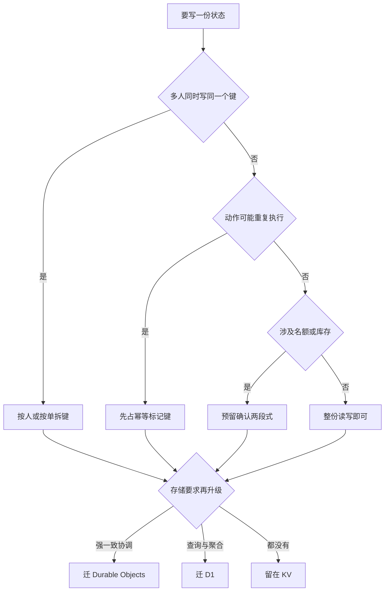

# 17 · KV 最终一致性与并发写

## 本篇讲什么

Cloudflare KV 是最终一致存储，这个「最终」在 Bot 场景里会咬人：读-改-写丢更新、刚写完读不到、list 看不全。这一篇用狼人杀 41 号的实测事故完整复盘成因，给出按人拆键等一套应对手法，并划清「什么时候 KV 不够用、该上 D1/DO」的界线。

## 核心概念

### 最终一致到底是什么意思

KV 的写入先落到中心，再异步传播到全球边缘。后果有三：

- **读己之写不可靠**：刚 put 完立刻 get，可能读到旧值甚至空（传播窗口通常秒级，偶尔更久）。
- **跨键无事务**：两个键一起改，中途失败就是一半新一半旧，没有回滚。
- **list 有缓存延迟**：按前缀列键的结果比直读更「旧」，拿 list 当实时名单用必翻车。

这不是 KV 的缺陷，是它的定位：为「读多写少、容忍秒级延迟」的数据优化。你的设计要顺着这个定位，而不是假装它是本地变量。

### 经典事故：读-改-写丢更新

最常见的状态存法是「一个键存整份 JSON」：读出来 → 改一个字段 → 写回去。单线程慢速操作时毫无问题，但两个更新几乎同时到达时：

1. 请求 A 读到状态 S，请求 B 也读到状态 S。
2. A 把自己的改动写回 S+a；B 把自己的改动写回 S+b。
3. 后写的覆盖先写的——**a 的改动凭空消失，且两个请求都返回成功**。

用户连点按钮、群里多人同时操作、webhook 重试与正常请求交叠，都是触发条件。它不报错、不留痕，是最阴险的一类 bug。

### 案例复盘：41 号狼人杀的名单丢失

狼人杀最初把整局状态（玩家表、阶段、行动箱、投票箱）存一个 `wolf:<群ID>` JSON。实测快速连点报名时，玩家收到「报名成功」，名单里却没有他——正是上面的读-改-写覆盖。更隐蔽的是第二幕：改成拆键后，自动结算一度仍卡住，根因是结算用 KV **list** 读票数，list 的边缘缓存延迟让「全员已投」迟迟凑不齐。

最终定版的设计：

- **按人拆键**：`wolf:` 只存对局元信息，玩家一人一键 `wolfp:`、夜晚行动 `wolfn:`、公投票 `wolfv:`。报名只写自己的键，物理上不存在互相覆盖。
- **逐键直读结算**：结算时按玩家名单逐个 get 各自的键，不用 list 汇总——直读的传播延迟远小于 list。
- 模块 35 的文档同步加了修订说明，单 JSON 版只保留作理解状态机的教学材料。

## 实操要点

先看全景——写状态之前先走一遍这张决策图：

1. **先问「谁会同时写这个键」**：只要答案不是「永远只有一个人慢慢写」，就别用整表读-改-写。按参与者/按订单/按天拆键，让每次写只碰自己的键。
2. **写后读回要容忍延迟**：业务上需要「写完马上读」的流程（如扣库存后确认），要么把确认数据随写随带（不回读），要么读回做短重试；测试时更要等待复读再判失败（见 16 篇）。
3. **幂等键兜底重复执行**：webhook 会重试（见 03 篇），同一个动作执行两遍的防护不是锁，而是幂等——先占 `paid:<id>`、`done:<id>` 这类标记键，已存在就跳过。标记键本身只写一次、从不读-改-写，天然安全。
4. **预留-确认两段式处理稀缺资源**：库存、名额这类「先到先得」的量，用「下单时预留（写预留键带过期时间）→ 成功实扣 → 超时自动释放」的形态逼近事务语义（模块 22 的购物车就是这套）。它不是真事务，但把超卖窗口压到可接受范围。
5. **聚合写**：计数类（群消息数、用量）先在单次请求内攒齐，一天一键一次写完——既省写额度（见 18 篇），又减少并发写同一键的概率。

## 什么时候 KV 不够用

出现下面任一信号，就该把那一块数据迁走（选型总论见 10 篇）：

- **需要跨行查询与聚合**（按条件筛订单、算总账）→ D1（SQL）。
- **需要强一致协调**（房间状态机、分布式锁、秒级结算）→ Durable Objects（单对象串行化天然无并发写问题）。
- **写频次高到撞额度或延迟敏感**（高频计数、实时排行）→ D1 或 DO，别在 KV 上硬扛。

迁移是局部的：一张订单表迁 D1，不代表全库都要迁；KV 继续管配置、映射、快照这些它擅长的东西。

## 常见坑

- **拿 list 当实时数据**：名单、队列、待办用 list 拼装，边缘延迟下永远少几个。名单维护显式索引键（数组存一个键里），或逐键直读。
- **用「先查有没有，再写」防重复**：查与写之间有传播窗口，并发下双双通过。改用幂等标记 + 写入后以标记为准的流程设计。
- **一个热键打天下**：全局计数器、全服名单存一个键，所有请求排队改它——拆键分片（按用户、按天、按群）是唯一解。
- **把传播延迟当数据丢失去「修复」**：刚写完读不到就重写、对账，越修越乱。先等、先复读，确认真丢了再动（16 篇的抖动识别）。

## 在本库里看哪里落地

- 事故的完整修复实现：模板 `41-werewolf`（拆键版状态设计）；模块文档的修订说明在 [modules/35 狼人杀](../../modules/35-werewolf.md) 开头。
- 键设计与注册表：[modules/04 KV 状态存储](../../modules/04-kv-store.md)。
- 预留-确认与防超卖：[modules/22 商店目录与购物车](../../modules/22-shop.md)；匹配队列的一人一键：[modules/50 匹配队列](../../modules/50-matching-queue.md)。
- 存储选型判据：[10 架构与规模化](10-architecture-scaling.md)。
