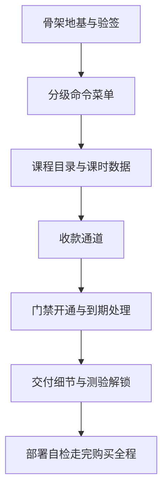

# 19 · 长文教程：从零拼一个付费课程 Bot 上线

## 本篇讲什么

一篇操作叙事：假设你要卖一门课，从「什么都没有」到「学员付钱、进频道、按课时学完」，全程只用本库的积木拼，不写新轮子。每一步都给出选哪块积木、为什么、去哪看实现细节——代码不在这里贴，去对应模块抄。

## 第 0 步：先把产品想成状态机

付费课程 Bot 的本质是四件事：**展示**（有什么课）、**收款**（怎么付）、**门禁**（付了才能进）、**交付**（课时怎么学）。外加一条运营线：**内容更新**（往频道里发新课时通知）。先在纸上把学员旅程走一遍：看到课程介绍 → 下单 → 付款 → 拿到入场券 → 进频道/开课时 → 学完打卡。旅程里每个箭头，就是后面要拼的一块积木。

## 第 1 步：选积木（对照旅程逐段选）

| 旅程段 | 选的积木 | 理由 |
|---|---|---|
| 课程展示 | 模块 22 商店目录（或直接用模板 56 的课程结构） | 目录、商品卡、分页都是现成的 |
| 下单与收款（小规模） | 模块 13 人工确认 | 零接入，先跑通生意 |
| 下单与收款（规模化） | 模块 24 Stars / 模块 49 Crypto Pay | 数字商品合规线走 Stars；加密用户群用 Crypto Pay（见 15 篇选型） |
| 门禁 | 模块 06 强制订阅校验 + 模板 14 的到期踢人 | 「付费频道」模式：进频道前先验资格 |
| 交付（二选一） | 模板 56 课程/LMS（Bot 内学）或模板 14+01（频道内学） | 结构化学习选 56；内容沉淀在频道选频道模式 |
| 内容更新 | 模块 05 频道发帖 | 管理员私聊发稿、预览、带按钮发进频道 |

本教程主线走「Bot 内学」（模板 56 为骨架），因为它把进度、测验、解锁都管在 Bot 里，最能体现拼装；频道模式的拼法在 docs/ASSEMBLY.md 有一篇完整的付费课程频道实战，两边对照着看。

## 第 2 步：组装顺序（别乱序，后面步步踩前面）

先看全景——五层积木的叠放次序：

1. **先立地基**：用模块 01 的骨架起一个空 Bot，配好 token、webhook 验签、命令菜单（模块 02 的分级菜单：学员只看 /courses /myprogress，管理员多出建课与确认类命令）。先部署一次，确认 /start 有回应——地基不验，后面全是叠床架屋。
2. **再装目录与课程数据**：按模块 22/模板 56 的键设计建课、加课时（标题、正文、测验题）。这一步先用一门 3 课时的样板课，把数据结构跑顺。
3. **接收款**：先接人工确认（模块 13）：学员点购买 → 生成订单 → 管理员收到确认卡 → 点已收款 → 触发开通。等订单量上来再换 Stars：替换点只有「支付确认」这一层，订单与开通逻辑不动——这正是当初把支付做成独立模块的回报。
4. **接门禁与开通**：开通动作做两件事——写资格记录（带到期时间）、给学员发入场方式（频道模式发一次性邀请链接，Bot 内学模式直接解锁课程）。到期处理挂 Cron：扫到期记录，频道模式踢人、Bot 模式锁课，提前一天发续费提醒。
5. **最后装交付细节**：课时翻页、测验答对才解锁下一课、进度查询。测验是课程 Bot 与「网盘式卖课」的分水岭，认真做。

组装中的冲突排查（回调前缀撞车、KV 键重复、多个 /start 抢答）按 docs/ASSEMBLY.md 的冲突清单逐项过——这一步省不得，拼装事故全出在这里。

## 第 3 步：部署与自检

按 docs/DEPLOY.md 走：建 Worker、绑 KV、token 进 Secret、访问 /setWebhook 注册。部署完先自己当一遍学员（用另一个账号或小号）：从 /start 到学完第一课完整走完，再用 getWebhookInfo 看一眼投递状态（见 11 篇）。**没亲自走完购买全程的 Bot，不许发给第一个真实学员**——支付链路的 bug 永远藏在你没走的那一步里。

## 第 4 步：收款上线的合规清单

- 数字课程在 Telegram 内收款走 Stars 是合规线（见 06/15 篇）；人工确认只适合冷启动期，订单一多立刻迁自动通道。
- 商品页写清：课程内容、有效期、退款政策。数字商品纠纷里，「事先写没写」就是判决依据。
- 发货（开通）只认支付成功事件且幂等（见 06 篇），人工确认模式下只认管理员点的那一下——任何「学员说付了」都不算。

## 第 5 步：运营期（上线才开始）

- **内容更新**：新课时先在 Bot 里加好，再用模块 05 的发稿流往频道/群发一条带深链的通知（深链直达新课时，见 05 篇），别只发「更新了」三个字。
- **数据看三样**：新订单数、开通成功率（付了没进来是最贵的 bug）、课时完成率（掉得最狠的那一课就是内容要改的那一课）。
- **续费与到期**：到期前提醒、到期后给宽限期再锁、老学员续费价——都在资格记录的到期字段上做文章，不用新系统。
- **备份**：课程内容与订单都在 KV 里，定期导出一份（键清单在模块 04 注册表里查），平台不是你的保险柜。

## 走完这条线你实际做了什么

回头看：你没有「开发一个课程系统」，你只是把目录、支付、门禁、交付四块积木按旅程拼起来，再用骨架把它们粘住。这就是本库的工作方式——新产品先拆旅程，再查模块库选积木，最后才是写那一点点粘合代码。

## 在本库里看哪里落地

- 本篇的成品骨架：模板 `56-course-lms`（课程/LMS 全套）、模板 14（付费会员/频道模式）、模板 62（Crypto Pay 收款）。
- 拼装方法与冲突清单：[docs/ASSEMBLY.md](../ASSEMBLY.md)（含付费课程频道组装实战）。
- 支付选型：[06 支付与变现](06-payments.md)、[15 加密支付](15-crypto-payments.md)。
