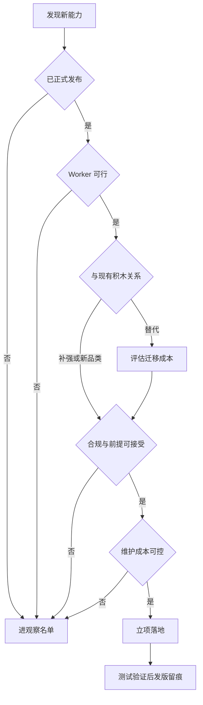

# 20 · 跟踪 Bot API 演进

## 本篇讲什么

Bot API 一直在长新能力：这一篇讲怎么系统地跟踪它（看什么源、怎么读更新日志）、拿到一个新能力时用哪五问评估要不要用、以及给本库这样的模板库做版本升级的标准流程。附 Managed Bots 从「观察名单」到「正式模板」的完整复盘。

## 核心概念

### 信息源：只订两个就够

- **官方更新日志**（core.telegram.org/bots/api 的 changelog 部分）：每次 API 版本发布逐条列新方法、新字段、行为变更。这是唯一权威源，评估任何新能力先回这里核对原文。
- **@BotNews 频道**：官方的发布广播，比翻文档省事，适合当提醒闹钟。

第三方博客、视频、AI 总结都只能当线索：它们会过时、会把「测试中」写成「已上线」、会漏掉前置条件。**线索用来发现，原文用来决策**——这是 02 篇查文档姿势的延伸。

### 读更新日志的正确姿势

每个版本条目扫三类东西：**新增**（新方法/新字段，可能开新品类）、**变更**（已有方法的参数、默认值、限制变了，可能影响线上代码）、**移除/弃用**（你用的东西哪天没了）。变更类最容易被忽略也最危险：比如某字段改了语义、某限制收紧，老代码不报错但行为悄悄变了。读完把与自己模板相关的条目摘出来，逐条对照代码——这就是升级评估的输入。

### 新能力评估五问

先看全景——五问是一条判定流，任何一问不过就进观察名单：

拿到任何新能力，先过这五问再决定动不动手：

1. **是否正式开放**：是正式版本里的 GA 能力，还是个别客户端的灰度/传闻？查 changelog 原文，有没有版本号。
2. **Worker 可行性**：它依赖什么运行条件？需要长连接、本地文件系统、MTProto 会话的，单文件 Worker 直接出局（见 12 篇的 MTProto 之辨）；只是新 HTTP 方法/新更新类型的，天然可行。
3. **与现有积木的关系**：是替代某块积木（替代就评估迁移成本）、补强某块（补强就想清接口怎么接）、还是全新品类（新品类就走盘点流程，见 docs/SURVEY.md 的方法）。
4. **合规与前提**：要不要用户开 Premium、要不要 BotFather 开模式、有没有政策限制（支付类尤其要看官方政策页）。
5. **维护成本**：这能力会不会很快又变？依赖它的模板要留多少适配层？官方亲儿子能力（如 Stars）值得深绑，边缘实验能力只做薄封装。

五问全过，才立项；只过一部分，就进观察名单并写明「差哪个条件」，条件变了再启动。

## 案例复盘：Managed Bots 从观察到落地

这是五问的一次完整实跑，时间线：

- **第一轮盘点时（观察）**：模块 21 文末把它记为「二期路线」——当时只知道官方在做受管 Bot，细节与开放程度未定。五问卡在第 1 问：不立项，只登记。
- **核实阶段**：查到 Bot API 9.6 正式引入，官方文档给出完整流程（bot-management 模式、深链、ManagedBotUpdated、getManagedBotToken/replaceManagedBotToken）。第 1、2 问通过（纯 HTTP 方法 + 新更新类型，Worker 可行）；第 3 问答案是「与模块 21 并行而非替代」（存量 Bot 入驻仍需自研路线）；第 4 问前提是管理 Bot 要开模式，可接受；第 5 问是版本级正式能力，值得做。
- **落地阶段**：建成模板 54，token 存储直接复用模块 21 的加密层——评估时预判的「并行关系」让两条路线共用一套安全基建，迁移成本几乎为零。
- **沉淀阶段**：经验写成 12 篇专文，02 篇的全景介绍同步更新指向。

复盘要点：**观察不是拖延，是把立项条件写下来等它成熟**。没有当初那句「二期路线」的登记，就不会有后来的快速核实与落地。

## 给模板库做版本升级的流程

1. **摘条目**：新版本 changelog 里筛出与本库相关的新增/变更/移除。
2. **过五问**：逐条评估，结论分三类——立即跟进、观察登记、不适用（写明理由）。
3. **改一处验一处**：跟进项落到具体模板/模块后，按 16 篇的方法论回放测试核心路径，涉及状态的读回 KV 验证。
4. **文档同步**：模块文档、知识库的对应篇目、注册表（新前缀/新键）一起更新——代码升级了文档没升，等于给下一个人埋雷。
5. **发版留痕**：版本说明里写清「因 API x.y 的某某变化，改了哪些模板」，未来出问题能按图索骥。

## 常见坑

- **追新追到生产事故**：新能力上线当天就往主力 Bot 上堆。先在测试 Bot 上验（见 16 篇），观察一两个版本再进主力。
- **把客户端功能当 API 能力**：某些新玩法是 Telegram 客户端 App 的功能，Bot API 并没有对应方法——评估第 2 问先查方法表。
- **只看新增不看变更**：限制收紧、字段弃用这类条目不显眼，但会让线上代码慢慢烂掉。changelog 要整页读完。
- **评估完不留痕**：这次说「不做」的理由不写下来，下次换个人又要重新评估一遍。观察名单就是团队的记忆。

## 在本库里看哪里落地

- API 全景与查文档姿势：[02 Bot API 全景](02-bot-api-overview.md)。
- 案例的成品：模板 `54-managed-bots` 与专文 [12 Managed Bots 全解](12-managed-bots.md)。
- 升级后的测试闭环：[16 Bot 测试方法论](16-testing-bots.md)；品类级盘点方法：docs/SURVEY.md 与 docs/SURVEY2.md。
