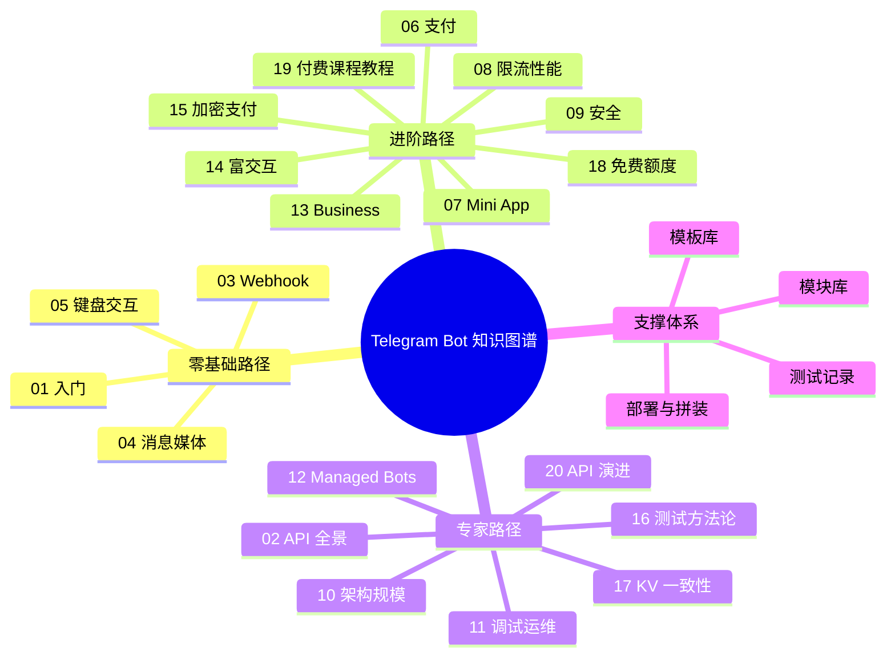

# Telegram Bot 开发知识库

从零基础到天花板：这一套文档只讲**知识与原理**——Bot 世界是怎么运转的、每个机制为什么这样设计、边界在哪里。**代码**不在这里，去 [modules/ 模块库](../../modules/README.md) 抄（50 篇）；**模板**在仓库根目录的 82 个编号目录与 3 个组合里；部署步骤看 [docs/DEPLOY.md](../DEPLOY.md)，拼装方法看 [docs/ASSEMBLY.md](../ASSEMBLY.md)，架构取舍看 [docs/DESIGN.md](../DESIGN.md)，测试记录看 [docs/TESTING.md](../TESTING.md)。

先看全景：

## 学习路径

### 🌱 零基础线（从没写过 Bot）

| 篇 | 内容 | 一句话 | 适合谁 |
|---|---|---|---|
| 01 | [零基础入门](01-getting-started.md) | Bot 不是「账号」，是一套 API；先建心智模型再写代码 | 所有人第一篇 |
| 03 | [更新与 Webhook](03-updates-webhook.md) | 你的代码是怎么「收到消息」的 | 写第一个 Bot 之前 |
| 04 | [消息与媒体](04-messages-media.md) | 消息的全谱、file_id、格式化排版的坑 | 开始发消息时 |
| 05 | [键盘与交互](05-keyboards-interaction.md) | 两种键盘、按钮回调、深链与命令菜单 | 开始做交互时 |

### 🚀 进阶线（Bot 能跑了，要做正经产品）

| 篇 | 内容 | 一句话 | 适合谁 |
|---|---|---|---|
| 06 | [支付与变现](06-payments.md) | Stars 与传统支付的全流程和合规线 | 要卖东西/收钱 |
| 15 | [加密支付](15-crypto-payments.md) | Crypto Pay 验签模型、TON 概念、四条收款路线选型 | 用户群在加密生态里 |
| 07 | [Mini App](07-mini-apps.md) | 网页前端 + Bot 后端的分工与验签 | 要做复杂界面 |
| 14 | [富交互能力谱](14-games-rich-interaction.md) | 游戏卡、付费媒体、原生投票、反应、Inline 全谱的边界 | 选交互形态时 |
| 13 | [Business 代答](13-business-api.md) | 替店主个人号自动回复的事件模型与分工 | 做小店/个体户生意 |
| 08 | [限流与性能](08-limits-performance.md) | 平台限额、429、广播队列与 Workers 上限 | 用户量上来之后 |
| 18 | [免费额度工程](18-free-tier-engineering.md) | 免费计划的四个额度维度与省流固定套路 | 想长期白嫖还不翻车 |
| 09 | [安全](09-security.md) | token、验签、鉴权、防刷与代管义务 | 上线之前必读 |
| 19 | [长文教程：付费课程 Bot](19-end-to-end-paid-bot.md) | 从选积木到收款上线，照着走完一个完整产品 | 进阶线毕业实战 |

### 🏔️ 专家线（做平台、做规模、做长期运维）

| 篇 | 内容 | 一句话 | 适合谁 |
|---|---|---|---|
| 02 | [Bot API 全景](02-bot-api-overview.md) | API 的组织方式与跟进新特性的姿势 | 想吃透官方能力边界 |
| 12 | [Managed Bots 全解](12-managed-bots.md) | 官方受管 Bot 的深链流程，与自研母体的选型 | 做母体/平台 |
| 10 | [架构与规模化](10-architecture-scaling.md) | 存储选型、多租户、拼装与拆分、成本模型 | 做母体/商城/多 Bot |
| 17 | [KV 最终一致性与并发写](17-kv-consistency.md) | 读-改-写丢更新的成因、拆键手法、何时迁 D1/DO | 被并发咬过的人 |
| 16 | [Bot 测试方法论](16-testing-bots.md) | 模拟回放、harness、副作用读回与 L1–L5 分级 | 要给 Bot 建质量体系 |
| 11 | [调试与运维](11-debug-ops.md) | 排障表、回放测试、灰度与回滚 | 长期维护者 |
| 20 | [跟踪 Bot API 演进](20-api-evolution.md) | 评估五问、观察名单、给模板库升级的流程 | 维护者必修 |

## 读法建议

- 每篇结构统一：本篇讲什么 → 核心概念 → 实操要点 → 常见坑 → 在本库里看哪里落地。
- 文中标注「以官方文档为准」的数字（限额、费率、尺寸上限等）会随平台政策变化，动手前去 [core.telegram.org/bots/api](https://core.telegram.org/bots/api) 复核一眼。
- 读完一篇就去对应的模板里看真实代码，知识和代码对照着看最快。
